# MediScan AI – Multimodal Medical Report Intelligence Platform

> **Transform Medical Reports Into Understandable Health Insights**

MediScan AI reads medical reports (JPG, JPEG, PNG, PDF), extracts the measurements with local OCR and deterministic parsing, asks the user to confirm them, and then runs separate analyses for **ECG**, **echocardiography (ECHO)**, **blood/CBC**, **liver function** and **lipid profile** reports.

> ⚠️ **Educational research prototype.** MediScan AI is not a medical device, has not been clinically validated and does not provide diagnoses. Clinical interpretation must be performed by a qualified healthcare professional.

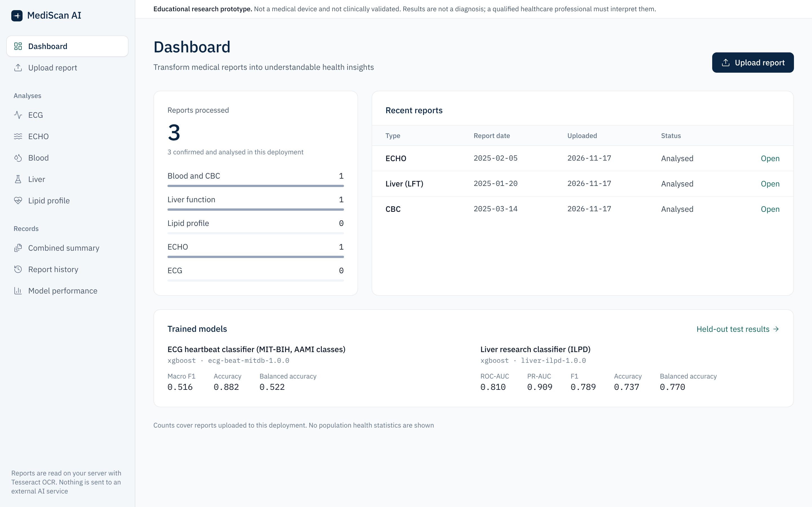

---

## Contents
1. [Project overview](#1-project-overview) · 2. [Business problem](#2-business-problem) · 3. [Dataset sources](#3-dataset-sources) · 4. [Dataset licensing](#4-dataset-licensing) · 5. [Architecture](#5-architecture) · 6. [OCR methodology](#6-ocr-methodology) · 7. [ECG processing](#7-ecg-processing) · 8. [ECHO report extraction](#8-echo-report-extraction) · 9. [Blood analysis](#9-blood-analysis) · 10. [Liver model](#10-liver-model) · 11. [Lipid analysis](#11-lipid-analysis) · 12. [XGBoost methodology](#12-xgboost-methodology) · 13. [Model comparison](#13-model-comparison) · 14. [Evaluation results](#14-evaluation-results) · 15. [Explainable AI](#15-explainable-ai) · 16. [Privacy & security](#16-privacy-and-security) · 17. [Local setup](#17-local-setup) · 18. [Deployment](#18-deployment) · 19. [Limitations](#19-limitations) · 20. [Future improvements](#20-future-improvements)

Further documents: [Technical report](docs/TECHNICAL_REPORT.md) · [Datasets & provenance](docs/DATASETS.md) · [Deployment guide](docs/DEPLOYMENT.md)

---

## 1. Project overview

| Module | Input | Method | ML model |
|---|---|---|---|
| **A · ECG** | CSV signal, ECG image/scan/PDF | Filtering, Pan-Tompkins-style R-peak detection, signal-quality indices, grid detection + waveform digitisation | XGBoost / Random Forest / 1-D CNN beat classifier (MIT-BIH, inter-patient split) |
| **B · ECHO** | Echo report (image/PDF) | OCR + structured field extraction, ASE/EACVI reference comparison, verbatim narrative findings | None (no suitably labelled data) |
| **C · Blood** | CBC / haematinic report | Reference-range comparison, documented pattern rules, index-consistency checks | None (see [why](docs/DATASETS.md#blood)) |
| **D1 · Liver** | LFT report | Reference comparison, De Ritis & R-ratio, derived bilirubin/globulin | XGBoost (+ LR / RF / GB) research score on ILPD with SHAP |
| **D2 · Lipid** | Lipid profile | Non-HDL, ratios, guarded LDL estimation (Friedewald / Sampson), NCEP ATP III categories | None (rule-based by design) |

End-to-end flow: **upload → validate file → async OCR job → classify report type → extract values/units/ranges/date → normalise units → validate → user reviews & corrects → confirm → analyse → combined summary / PDF**. No analysis is run before the user confirms the extracted values.

| Upload | Review & correct | Blood analysis |
|---|---|---|
| 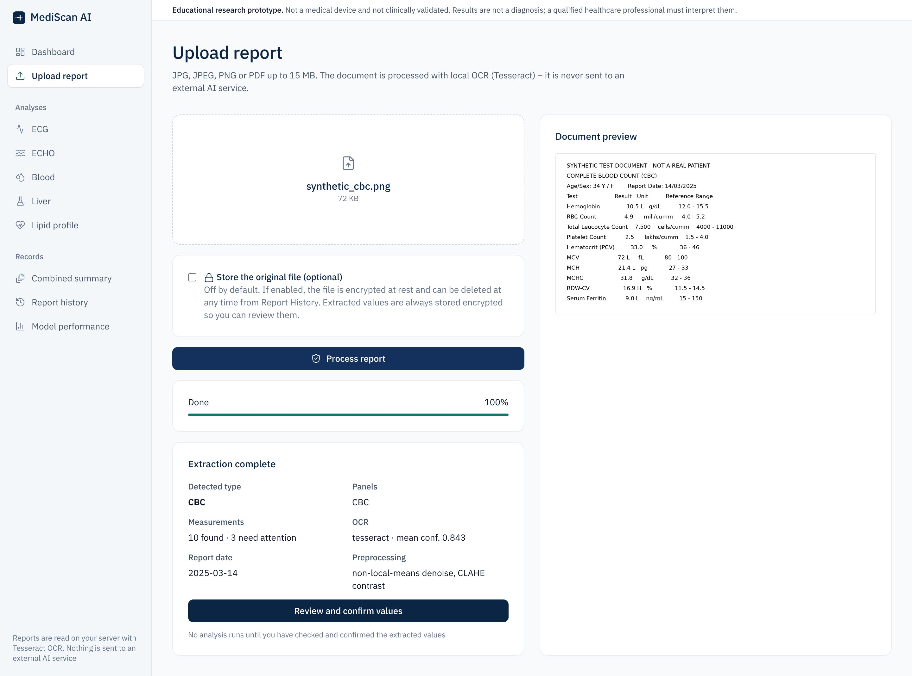 | 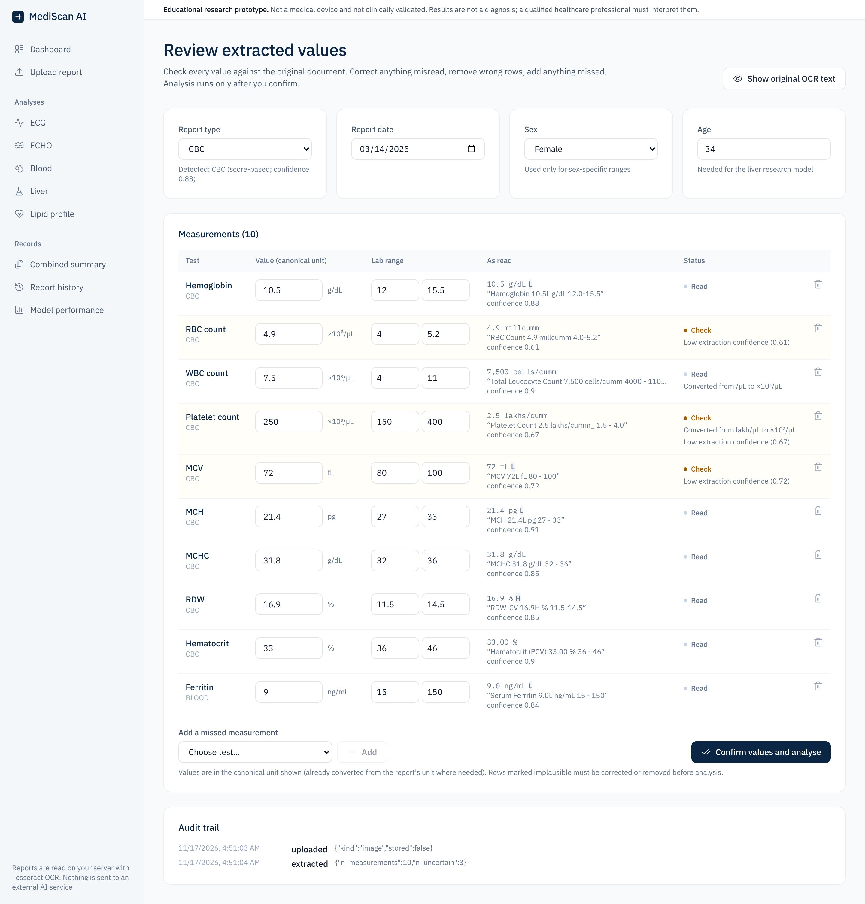 | 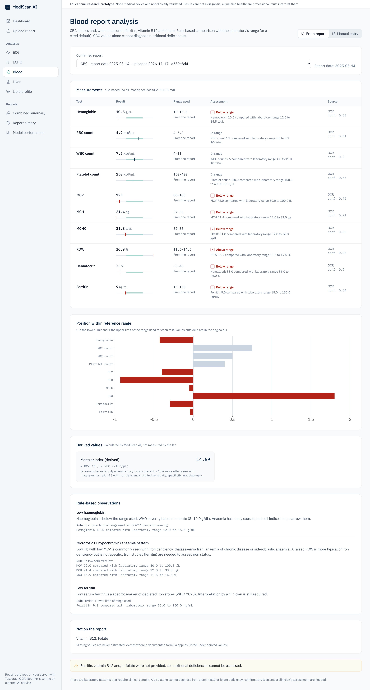 |
| **Liver (XGBoost + SHAP)** | **Lipid** | **ECHO** |
| 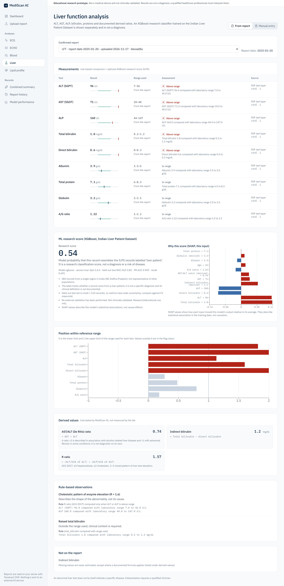 | 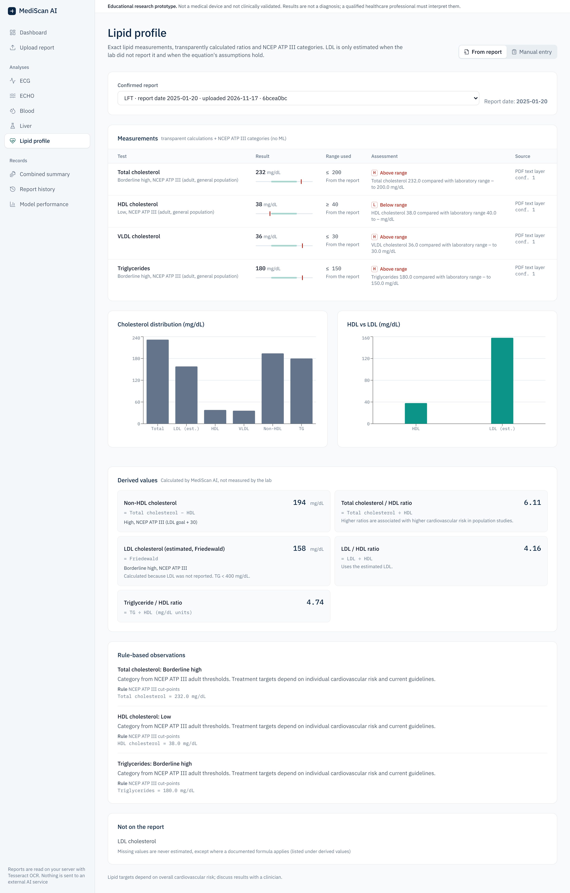 | 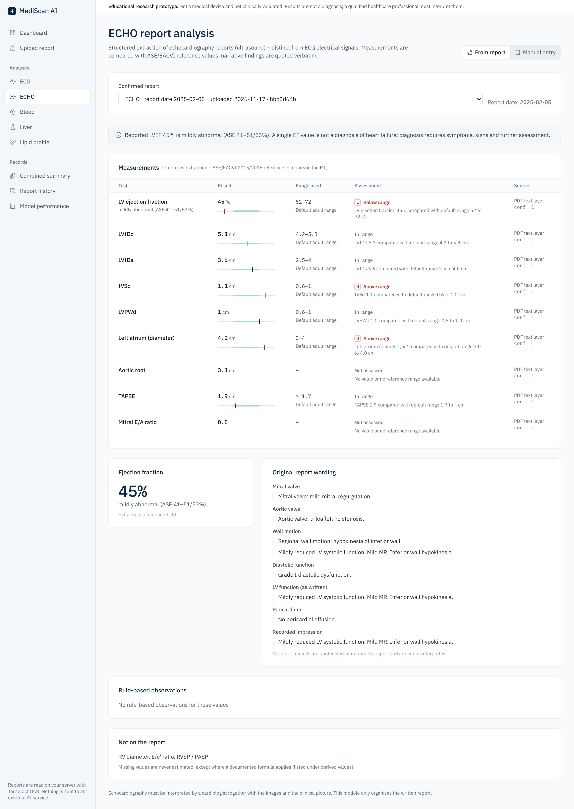 |
| **ECG signal** | **ECG image digitisation** | **Model performance** |
| 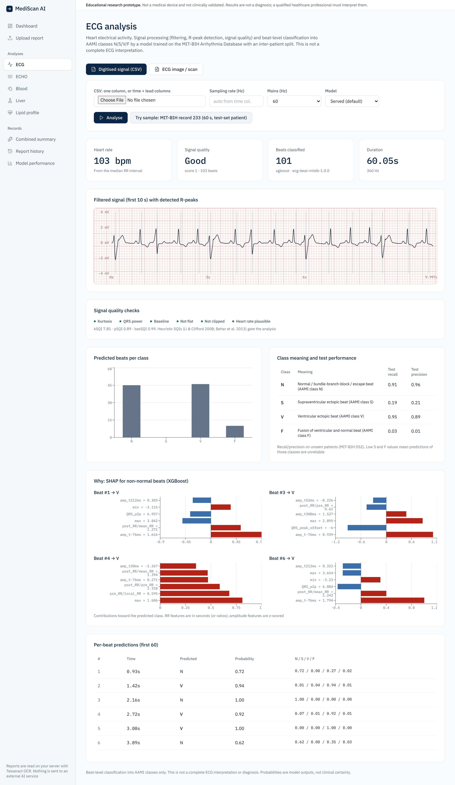 | 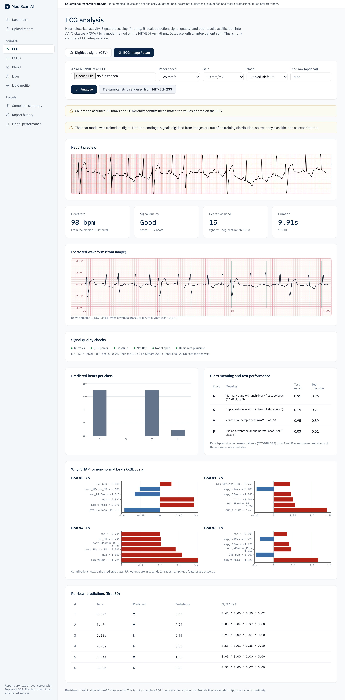 | 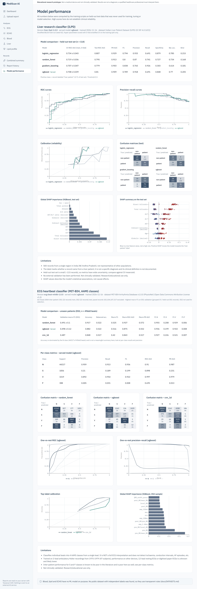 |

The interface follows an "unslop" design pass (direction: careful, clinical, plain-spoken; world: the printed lab result sheet and ECG grid paper) using [unslop](https://github.com/heydamir/unslop) by Damir Sokolovsky ([@heydamir](https://x.com/heydamir)), CC BY 4.0: one ink-tinted neutral ramp, a single teal accent, IBM Plex Sans/Mono (self-hosted), lab-sheet H/L flags, and the reference-range tick as the signature detail.

Screenshots were taken from the running application (Next.js production build + FastAPI) using **synthetic test documents** that are clearly labelled “SYNTHETIC TEST DOCUMENT” and a real MIT-BIH test-set recording.

## 2. Business problem

Patients and non-specialist staff receive lab and cardiology reports as photos or PDFs in heterogeneous layouts and units (e.g. platelets in *lakhs/cumm* vs ×10³/µL, bilirubin in mg/dL vs µmol/L). Turning these into structured, validated data is slow and error-prone. MediScan AI demonstrates a safe pipeline that (a) digitises the values with confidence scores and an audit trail, (b) never silently guesses an unreadable value, and (c) explains every flag with the exact rule and reference range used — while being explicit about what the models can and cannot say.

## 3. Dataset sources

| # | Dataset | Used for | Status in this repo |
|---|---|---|---|
| 1 | [Kaggle ECG Heartbeat Categorization](https://www.kaggle.com/datasets/shayanfazeli/heartbeat) (derived from MIT-BIH) | Optional intra-patient benchmark (`--kaggle-dir`) | Loader + schema validation implemented. **Not used for the shipped model** because its CSVs have no patient IDs (see §7). |
| 1b | [MIT-BIH Arrhythmia Database v1.0.0](https://physionet.org/content/mitdb/1.0.0/) (PhysioNet) | **Training/testing the shipped ECG models** with record-aware DS1/DS2 split | Used (48 records, header checksums verified) |
| 2 | [Kaggle dsv/19217307 ECG images](https://www.kaggle.com/datasets/dsv/19217307) | ECG image digitisation evaluation | **Not accessed** (Kaggle not reachable from the build environment). Digitiser tested on a strip rendered from a real MIT-BIH signal. |
| 3 | [echo2022 competition](https://www.kaggle.com/c/echo2022/data), [Mendeley nvx2kchfyh](https://data.mendeley.com/datasets/nvx2kchfyh/1) | ECHO research | **Not accessed**; no ECHO model is claimed. Manual install workflow documented. |
| 4 | [Indian Liver Patient Records](https://www.kaggle.com/datasets/uciml/indian-liver-patient-records) (UCI ILPD) | **Liver models** | Used (583 rows; provenance & verification in [DATASETS.md](docs/DATASETS.md#ilpd)) |
| 5 | [Blood cell images](https://www.kaggle.com/paultimothymooney/blood-cells) | Investigated | Not used: WBC-type images cannot inform iron/B12/folate status. |
| 6 | [Cardiovascular disease dataset](https://www.kaggle.com/datasets/sulianova/cardiovascular-disease-dataset) | Investigated (EDA notebook) | Not used for lipids: cholesterol is only an ordinal 1–3 category. |

`scripts/download_datasets.sh` downloads everything with the Kaggle CLI and `wfdb`. Datasets are **not** committed to the repository.

## 4. Dataset licensing

* ILPD – UCI Machine Learning Repository, **CC BY 4.0** (Ramana & Venkateswarlu, 2012).
* MIT-BIH Arrhythmia Database – PhysioNet, **Open Data Commons Attribution v1.0**. Cite Moody GB, Mark RG. *IEEE Eng Med Biol* 20(3):45-50 (2001) and Goldberger et al., *Circulation* 101(23) (2000). The shipped sample files in `backend/sample_data/` are excerpts of record 233 and are redistributed under ODC-By.
* Kaggle datasets carry their own licences — check each dataset page before use (`echo2022` requires accepting competition rules).

## 5. Architecture

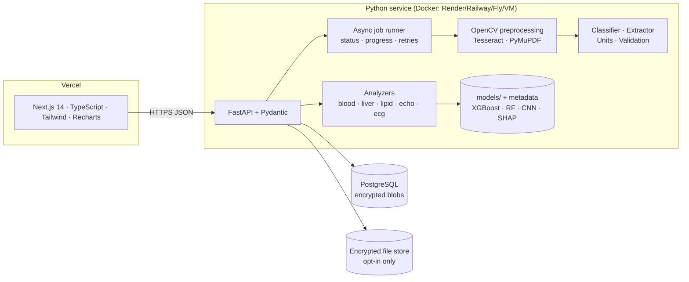

```
MediScan-AI/
├── frontend/            Next.js app (10 pages) – deploy to Vercel (root directory = frontend)
├── backend/
│   ├── main.py  config.py  database.py  security.py  schemas.py
│   ├── routes/          upload · reports (history, confirm, summary, stats) · analysis (blood/liver/lipid/echo) · ecg · models
│   ├── services/        ocr_service · document_classifier · measurement_extractor · units · validation_service
│   │   │                pipeline · jobs · report_generator
│   │   └── analyzers/   blood · liver · lipid · echo · ecg · reference (cited default ranges)
│   ├── sample_data/     MIT-BIH 233 excerpt (CSV) + rendered strip (PNG)
│   ├── Dockerfile  requirements.txt
├── ml/
│   ├── common/          metrics (all evaluation maths), paths
│   ├── liver/           data validation · features · train
│   ├── ecg/             signal_processing · beat_dataset · cnn · train · predict · image_digitizer
│   ├── blood/ lipid/ echo/   READMEs explaining why these are rule-based
│   └── model_registry.py
├── models/              trained artefacts + models/metadata/*.json (metrics shown by the UI)
├── reports/             evaluation JSON + figures (SHAP, ROC/PR, confusion matrices)
├── notebooks/           executed EDA notebooks (liver, ECG, cardiovascular)
├── tests/               64 pytest tests + synthetic fixture generator
├── docs/                technical report · datasets · deployment · screenshots
└── scripts/             download_datasets.sh · make_sample_data.py · build_notebooks.py
```

API routes for the per-module analyses live together in `backend/routes/analysis.py` (`/api/blood/analyze`, `/api/liver/analyze`, `/api/lipid/analyze`, `/api/echo/analyze`) because they share one validation path. Interactive API docs: `http://localhost:8000/docs`.

## 6. OCR methodology

1. **File validation** – extension *and* magic bytes, size limit, full Pillow decode (decompression-bomb guard), PDF page limit, encrypted PDFs rejected.
2. **PDFs** – the embedded text layer is used first (exact, confidence 1.0) and additionally re-assembled into table rows from word boxes. Pages without text are rasterised at 300 dpi and OCR'd.
3. **Images** – EXIF orientation → Tesseract OSD for 0/90/180/270° (verified by comparing word confidence when OSD is unsure) → Hough-based deskew (±15°) → non-local-means denoising → CLAHE contrast → upscaling for small images → blur detection (variance of Laplacian).
4. **OCR** – Tesseract LSTM (`--oem 1 --psm 6`) with word-level confidences, reconstructed into lines.
5. **Report-type detection** – transparent keyword scoring over six panels (ECG, ECHO, CBC, iron/vitamins, LFT, lipid); multi-panel reports are supported; the user can override.
6. **Extraction** – a catalogue of 40 analytes with lab synonyms (e.g. *SGPT/ALT*, *TLC/WBC*, *PCV/Hct*) and exclusion rules (MCH ≠ MCHC, HDL ≠ non-HDL, LDL/HDL ratio ≠ LDL). For each line: first number after the label, lab flag (H/L/*), unit, reference range (`a – b`, `< x`, `> x`, `up to x`). OCR digit confusions (`1O.5`), Indian digit grouping (`2,50,000`), decimal commas and glued labels (`LA4.2cm`) are handled and flagged.
7. **Unit normalisation** – documented factors (e.g. bilirubin µmol/L ÷ 17.1, cholesterol mmol/L × 38.67, TG × 88.57, platelets lakh/µL × 100). An unknown/missing unit is **never guessed**: the value is set to *uncertain* with no numeric value.
8. **Validation** – plausibility limits catch misreads (e.g. MCH 214 pg), cross-field identities (direct ≤ total bilirubin, HDL < TC, albumin < total protein, LVIDs < LVIDd, MCHC ≈ Hb/Hct, MCH ≈ Hb/RBC, MCV ≈ Hct/RBC), low-confidence gating (< 0.80), duplicates with conflicting values.
9. **Review & correction** – the user sees the value, unit, “as read” text, source line, confidence and issues; can edit, delete or add values. Every change is recorded in an encrypted **audit trail**. Original OCR text is preserved (encrypted) and viewable on request.
10. **Report date** and **age/sex** (only these, for ranges and the liver model) are extracted; names/IDs are never extracted.

## 7. ECG processing

* **Signal pipeline** (`ml/ecg/signal_processing.py`): 0.5 Hz zero-phase high-pass (baseline wander), IIR notch at mains frequency (50/60 Hz), 40 Hz low-pass; Pan-Tompkins-style detector (5–15 Hz band-pass → derivative → squaring → moving-window integration → adaptive threshold → refinement); RR intervals; heart rate from median RR; **signal-quality indices** (kSQI, pSQI, basSQI, flat-line, clipping, HR plausibility). Classification and HR are suppressed when quality is poor.
* **Beat representation**: resample to 125 Hz, window −0.30 s…+0.50 s around R (99 samples), per-beat z-score, plus 7 RR features (pre, post, local-10, and ratios to local/recording mean).
* **Why not the Kaggle CSV split?** The Kaggle heartbeat CSVs (187 samples + label per beat) contain no record/patient identifiers, so beats from the same patient appear in both train and test. The shipped models are therefore trained on the raw **MIT-BIH** records (the Kaggle data's source) with the standard **de Chazal et al. (2004) inter-patient split**: DS1 (22 records) for training/tuning, DS2 (22 different patients) for testing; paced records 102/104/107/217 excluded (AAMI EC57). The Kaggle loader remains for an optional, clearly-labelled intra-patient benchmark.
* **Supported classes**: N, S, V, F (AAMI). Q is **not supported** (≈15 examples remain after excluding paced records).
* **Image ECGs** (`ml/ecg/image_digitizer.py`): colour/grey grid detection, small-box spacing from autocorrelation (avoids harmonics), waveform mask, lead-row segmentation, column-wise trace extraction preserving peaks, calibration from grid (25 mm/s, 10 mm/mV assumed and stated; user-selectable). **If the grid is not detected, no HR/intervals/classification are produced.** On a strip rendered at 200 dpi from MIT-BIH 233, the detected grid was 7.95 px/mm (true 7.87, 0.9 % error) and HR 97.7 bpm vs 97.3 bpm from the source signal. Image-derived signals are flagged as out-of-distribution for the beat model.

## 8. ECHO report extraction

Numeric fields: LVEF, LVIDd, LVIDs, IVSd, LVPWd, LA diameter, aortic root, RV diameter, TAPSE, E/A, E/e′, RVSP/PASP (cm/mm normalised). Narrative fields are quoted verbatim: valve findings per valve, wall motion, diastolic function, pericardium, LV function wording and the **recorded impression**. Values are compared with ASE/EACVI 2015/2016 ranges (sex-specific where defined). **EF is never inferred from qualitative text**, and no heart-failure label is produced from a single value. ECHO (ultrasound) and ECG (electrical) are separate modules and the classifier explicitly disambiguates them.

## 9. Blood analysis

CBC (Hb, RBC, WBC, platelets, MCV, MCH, MCHC, RDW, Hct) and, if present, ferritin, B12, folate. Lab-printed ranges are used when available; otherwise cited adult defaults (WHO 2011 anaemia thresholds, WHO 2020 ferritin, Merck Manual). Pattern rules: low Hb (WHO severity), microcytic/macrocytic/normocytic patterns, low ferritin / B12 / folate (only when measured), leukocyte and platelet ranges, Mentzer index (only flagged as applicable with microcytosis). The output repeatedly states that **CBC alone cannot diagnose iron, B12 or folate deficiency**. No ML model: see [docs/DATASETS.md](docs/DATASETS.md#blood).

## 10. Liver model

Rule layer: reference comparison, AST/ALT (De Ritis), indirect bilirubin, globulin, A/G ratio, **R ratio** (ACG 2017: hepatocellular / cholestatic / mixed, only when ALT or ALP is raised). ML layer: four classifiers trained on ILPD; **XGBoost is served** and returns a *research classification score* with per-input SHAP contributions. The score requires age, sex and seven LFT values; it is never computed from partial input. The ILPD label (“liver patient”) is not a diagnosis.

## 11. Lipid analysis

Exact TC, HDL, LDL, VLDL, TG; derived **non-HDL**, **TC/HDL**, **LDL/HDL**, **TG/HDL**. If the lab did not report LDL: **Friedewald** only when TG < 400 mg/dL, **Sampson/NIH equation 2** for 400–800 mg/dL, and **no estimate** above 800 mg/dL. VLDL is estimated (TG/5) only when TG < 400. Every derived value is labelled “calculated by MediScan AI”. Categories follow NCEP ATP III; lab ranges are preferred where printed. A consistency check warns when reported LDL differs from TC−HDL−TG/5 by > 30 mg/dL. No ML model (a model predicting already-measured values would add nothing).

## 12. XGBoost methodology

* scikit-learn `Pipeline` per model: deterministic feature derivation (`FunctionTransformer`) → `ColumnTransformer` (median imputation; log1p + scaling for skewed features in the linear model) → classifier. Fitted inside CV folds only ⇒ no leakage.
* **Liver**: exact duplicate rows (13) removed *before* splitting; stratified 80/20 hold-out (seed 42); `RandomizedSearchCV` (40 iterations, stratified 5-fold, ROC-AUC) on the training split only; class imbalance via `scale_pos_weight` / `class_weight="balanced"`; test set evaluated once.
* **ECG**: GroupKFold by **record** on DS1 for tuning (RF and XGBoost, balanced sample weights; CNN with sqrt-inverse-frequency class weights and early stopping on 4 held-out DS1 records); the served model is chosen on DS1 validation macro-F1 — DS2 is never used for selection.
* Metrics: accuracy, balanced accuracy, precision, recall, specificity, F1, ROC-AUC, PR-AUC, Brier score, confusion matrix, calibration curves (`ml/common/metrics.py`).

## 13. Model comparison

**Liver – ILPD held-out test set (n = 114; 81 positive)**

| Model | CV ROC-AUC (train) | Test ROC-AUC | PR-AUC | F1 | Precision | Recall | Specificity | Brier |
|---|---|---|---|---|---|---|---|---|
| Logistic regression | 0.734 ± 0.043 | 0.807 | 0.929 | 0.794 | 0.933 | 0.691 | 0.879 | 0.215 |
| Random forest | 0.719 ± 0.036 | 0.795 | 0.913 | 0.800 | 0.870 | 0.741 | 0.727 | 0.168 |
| Gradient boosting | 0.707 ± 0.047 | 0.779 | 0.903 | 0.838 | 0.765 | 0.926 | 0.303 | 0.181 |
| **XGBoost (served)** | 0.708 ± 0.039 | **0.810** | 0.909 | 0.789 | 0.918 | 0.691 | 0.848 | 0.205 |

The test ROC-AUCs are higher than the CV estimates; with only 114 test records this is within sampling noise, and the CV means (≈0.71–0.73) are the more conservative estimate. Logistic regression is statistically indistinguishable from XGBoost here; XGBoost is served for the project's XGBoost/SHAP focus, not because it is clearly better.

**ECG – MIT-BIH DS2, 22 unseen patients (49 660 beats: N 44 217, S 1 836, V 3 219, F 388)**

| Model | DS1 val. macro-F1 | Accuracy | Balanced acc. | Macro F1 | F1 N | F1 S | F1 V | F1 F |
|---|---|---|---|---|---|---|---|---|
| Random forest | 0.491 ± 0.100 | 0.917 | 0.522 | 0.525 | 0.955 | 0.208 | 0.929 | 0.006 |
| **XGBoost (served)** | 0.498 ± 0.120 | 0.882 | 0.522 | 0.516 | 0.936 | 0.199 | 0.922 | 0.008 |
| 1-D CNN | 0.487 | 0.848 | 0.517 | 0.420 | 0.927 | 0.226 | 0.521 | 0.007 |

Served XGBoost per class (precision / recall): N 0.959 / 0.913 · S 0.210 / 0.189 · V 0.892 / 0.954 · F 0.005 / 0.031.

## 14. Evaluation results

What the numbers say, plainly:
* **Liver**: moderate discrimination (ROC-AUC ≈ 0.7–0.8) on a small, single-centre dataset whose label is not a diagnosis. Useful as a demonstration of a leakage-free tabular pipeline with SHAP, not as a screening tool.
* **ECG**: ventricular ectopic beats (V) transfer well to unseen patients (recall 0.95, precision 0.89). **Supraventricular (S) and fusion (F) beats do not** (F1 ≈ 0.2 and ≈ 0.01). This is consistent with the inter-patient literature and is why the UI shows per-class test recall/precision next to every prediction. The 0.88–0.92 accuracy mostly reflects the 89 % N prevalence. The CNN's F-class performance is additionally limited because most DS1 F beats come from record 208, which was in its validation fold.
* Development history (disclosed for transparency): the ECG feature set was revised once after a first full run (RR features normalised by the recording's mean RR were added). First-run DS2 macro-F1 was 0.513 (RF) / 0.518 (XGB) / 0.455 (CNN); the revision changed results only marginally. No further changes were made after seeing DS2.
* Full machine-readable results: `models/metadata/*.json`, `reports/*_evaluation.json`; figures in `reports/figures/`.

High accuracy does not establish clinical reliability; no external or prospective validation has been performed.

## 15. Explainable AI

* **Global**: mean |SHAP| importance and a beeswarm summary (liver, test set); per-class SHAP importance (ECG, DS2 sample). Top liver features: direct bilirubin, total bilirubin, ALP, ALT, AST. Top ECG features: pre-RR / mean-RR, pre-RR, pre-RR / local-RR — i.e. prematurity, as expected for ectopic beats.
* **Individual**: per-input SHAP waterfalls for each liver score; SHAP top features for each non-N beat (XGBoost).
* **Rule-based modules** show the exact rule, the range used and its source — no SHAP is invented for rules.
* All SHAP text states that values describe statistical association in the training data, not causation.

## 16. Privacy and security

* Local OCR (Tesseract) and deterministic parsing; **no report is sent to an external AI service**. The app works fully offline.
* Original files are **not stored by default**; storage requires an explicit consent checkbox and the file is Fernet-encrypted at rest.
* OCR text, extracted measurements, analyses and audit details are stored as **encrypted blobs** (Fernet/AES-128-CBC + HMAC); only non-identifying metadata (type, status, counts, dates) is in clear.
* Names, IDs, addresses and phone numbers are never extracted. Logs record only exception *types*, never document content; error responses never echo content.
* Upload hardening: size limit, extension + magic-byte check, full image decode, decompression-bomb limit, PDF page limit, encrypted PDFs rejected, PDFs rasterised/read only (no script execution).
* Optional API key (`MEDISCAN_API_KEY`), strict CORS allow-list, security headers (nosniff, DENY framing, no-referrer, no-store), HSTS + HTTPS redirect behind a proxy (`ENFORCE_HTTPS=true`).
* Deletion: per report or “delete all data” (DB rows, audit trail and stored files).
* Not implemented (documented as future work): user accounts / per-user access control. With a single shared deployment, anyone with the URL (and API key, if set) can see all stored reports — deploy privately or add authentication before using real data.

## 17. Local setup

Prerequisites: Python 3.11+ (tested on 3.13), Node 18.18+ (tested on 22), Tesseract 5 (`apt install tesseract-ocr` / `brew install tesseract` / [Windows installer](https://github.com/UB-Mannheim/tesseract/wiki)).

```bash
# backend (from the repository root)
python -m venv .venv && source .venv/bin/activate          # Windows: .venv\Scripts\activate
pip install -r requirements-dev.txt
uvicorn backend.main:app --reload --port 8000              # http://localhost:8000/docs

# frontend
cd frontend && cp .env.example .env.local && npm install && npm run dev   # http://localhost:3000

# tests
pytest -q                                                  # 64 tests
```

Trained models are included in `models/`, so the app runs without downloading any dataset. To retrain:

```bash
bash scripts/download_datasets.sh                     # needs ~/.kaggle/kaggle.json
python -m ml.liver.train --data datasets/liver/indian_liver_patient.csv     # ~2 min
python -m ml.ecg.train   --mitdb datasets/mitdb                             # ~5 min CPU
python -m ml.ecg.train   --mitdb datasets/mitdb --kaggle-dir datasets/heartbeat   # + optional Kaggle benchmark
python scripts/build_notebooks.py                     # re-execute EDA notebooks
```

Full stack with PostgreSQL: `docker compose up --build` (set `MEDISCAN_ENCRYPTION_KEY` in `.env`).

## 18. Deployment

Vercel hosts the **frontend only**; the OCR/ML API needs Tesseract, OpenCV, XGBoost and PyTorch, which exceed Vercel's Python serverless function limits (250 MB unzipped bundle, no system packages such as Tesseract) — so it runs as a Docker service. Step-by-step instructions: [docs/DEPLOYMENT.md](docs/DEPLOYMENT.md).

1. **Backend** → Render (Blueprint `render.yaml`, Docker, ≥ 2 GB RAM plan + managed PostgreSQL) or Railway/Fly.io/any VM (`backend/Dockerfile`).
2. **Frontend** → Vercel: import the GitHub repo, **Root Directory = `frontend`**, set `NEXT_PUBLIC_API_URL=https://<your-api>`; then set `CORS_ORIGINS=https://<your-app>.vercel.app` on the backend. The frontend is a static export, so you can also run `npm run build` in `frontend/` and drag the generated `out/` folder onto Vercel Drop (dropping the source folder itself gives `404: NOT_FOUND`).

Long-running processing uses the async job API (`POST /api/reports/upload` → `GET /api/jobs/{id}` with status, progress and automatic retry). **Deployment status:** the production build (`next build`) and the Docker-free API were tested locally; the application has not been deployed to a public URL from this build environment (no Vercel/GitHub credentials). Do not treat it as deployed until you have run the steps above and checked `/health`.

## 19. Limitations

* OCR was tested on synthetic, cleanly typed documents and their rotated/skewed/blurred variants; real-world photos with tables, stamps, handwriting or multi-column layouts will produce more uncertain values. Layouts that put the reference range before the result are not parsed (they are skipped, not misread).
* ECG beat model: 4 AAMI classes from one lead, weak S/F performance on unseen patients, trained on 1970s Holter data; image-digitised ECGs are out of distribution. Not an ECG interpretation (no intervals, axis, ischaemia, AF episodes).
* Liver model: 583 records from one Indian region; label not a diagnosis; small test set; no external validation.
* Default reference ranges are generic adult values; children, pregnancy and lab-specific methods are not handled unless the lab range is printed.
* No ECHO image/video model and no ECG-image dataset evaluation (datasets 2/3 were not accessible from the build environment).
* The ILPD file used for training was reconstructed from two public mirrors and verified against the published statistics (see [DATASETS.md](docs/DATASETS.md#ilpd)); re-train from the official Kaggle/UCI download for full reproducibility.
* Single-process job queue (fine for a demo; use Redis + RQ/Celery for multiple replicas). No user accounts.

## 20. Future improvements

User accounts with per-user encryption keys and row-level access control · Redis-backed job queue · PaddleOCR / table-structure recognition as an optional engine · layout-aware extraction (key-value table detection) and an OCR benchmark on de-identified real reports · evaluation of the digitiser on the ECG-image dataset and PTB-XL 12-lead models · patient-specific ECG adaptation for S/F classes · ECHO view classification / EF estimation on EchoNet-Dynamic with a separately evaluated model · FHIR export · i18n for Hindi/regional-language reports.

---

*Citations*: de Chazal P, O'Dwyer M, Reilly RB (2004) IEEE TBME 51(7):1196-1206 · Kachuee M, Fazeli S, Sarrafzadeh M (2018) ECG Heartbeat Classification: A Deep Transferable Representation, ICHI · Pan J, Tompkins WJ (1985) IEEE TBME 32(3) · Li Q, Mark RG, Clifford GD (2008) Physiol Meas 29(1) · Lang RM et al. (2015) JASE 28(1) · Nagueh SF et al. (2016) JASE 29(4) · Kwo PY et al. (2017) Am J Gastroenterol 112 · Friedewald WT et al. (1972) Clin Chem 18(6) · Sampson M et al. (2020) JAMA Cardiol 5(5) · NCEP ATP III (2002) Circulation 106 · WHO (2011, 2020) · Lundberg SM, Lee SI (2017) NeurIPS (SHAP).
